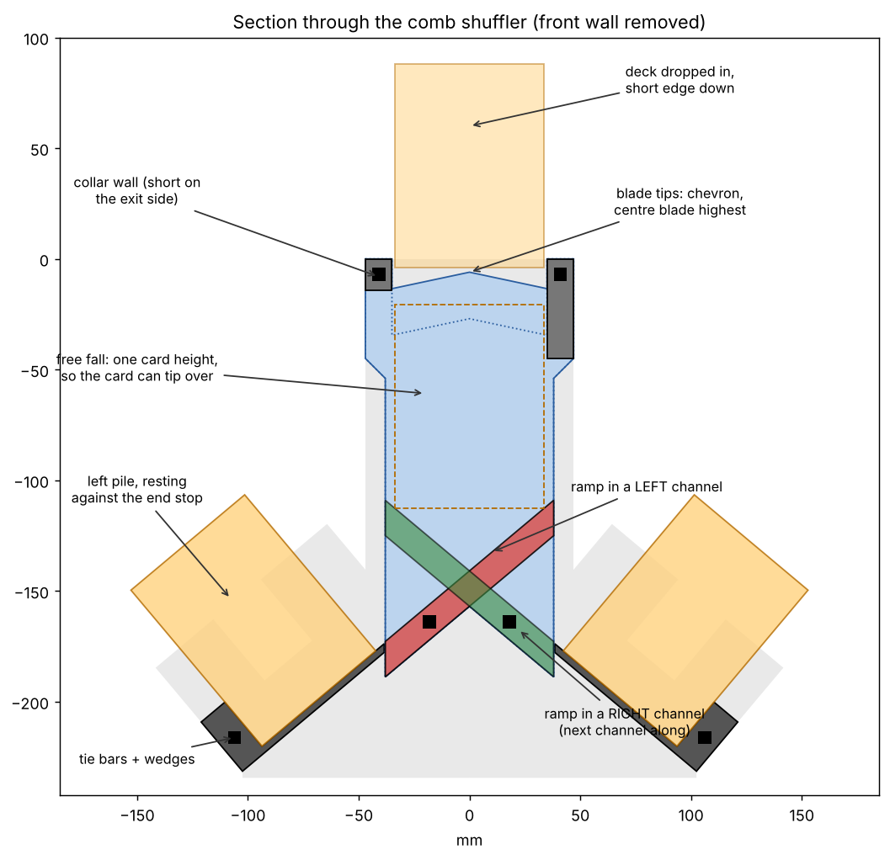

# Gravity comb shuffler for sleeved cards

A fully 3D-printed shuffler with no motor, springs, screws or moving parts.
Drop a 60-card sleeved deck in the top, lift two piles out of the bins, stack
them, drop again.

**Status: a design, not a tested product.** The geometry is checked by the
test suite (fit, clearances, no collisions, printability) and the mixing is
simulated, but nothing here has been printed. Expect to tune a parameter or two
after a first print; see "Likely tuning" below.




## How it works

1. **Collar.** The deck goes in short edge down. The opening is 70 x 66 mm, so
   the 42 mm deck has about 24 mm of slack front to back. That slack is
   deliberate: where the deck lands decides where the blades cut.
2. **Comb.** Thirteen 1.2 mm blades split the deck into packets of about five
   cards. The tips form a chevron (centre blade highest, each neighbour 3.5 mm
   lower), so the deck is split one blade at a time and each split pushes the
   outer cards sideways before the next blade arrives. Hitting all blades at
   once would jam.
3. **Ramps.** Each channel has a 40 degree floor. Channels alternate left,
   right, left, right. A packet free-falls one card height, lands on a corner,
   tips onto its short edge and slides out sideways.
4. **Bins.** Left-going and right-going packets collect in two tilted bins,
   squared against an end stop, with finger notches for lifting them out.
5. **Repeat.** Put the left pile on the right pile and drop again.

One drop is an inverse riffle shuffle done in clumps of five cards rather than
single cards, so it takes more drops than a hand riffle.

| Drops | Originally adjacent pairs still together | Notes |
|---|---|---|
| 1 | 75% | |
| 5 | 24% | |
| 7 | 14% | every card is equally likely to be at any position |
| 10 | 7% | reasonable for casual play |
| 15 | 3% | matches a random deck (1.7%) to within noise |

These come from `shuffle_sim.py`, which assumes the cut positions vary from
drop to drop. If you always press the deck against the same wall, vary it.

## Size and printing

Assembled: 283 wide x 72 deep x 234 tall mm. Needs a bed of at least
250 x 250 mm (the wall halves are 142 x 234 mm). About 350 g of filament at 15%
infill. No supports anywhere.

| File (in `out/`) | Qty | Orientation |
|---|---|---|
| `slice_00` ... `slice_13` | 1 each | as exported: blade on the bed, rib up |
| `back_L`, `back_R` | 1 each | as exported: wall on the bed, bin floor standing up |
| `front_L`, `front_R` | 1 each | flat |
| `bar` | 6 | as exported: lying down, slot vertical |
| `wedge` | 6 | flat |
| `foot` | 2 | on its side |

`out/assembly.step` is the whole machine for viewing or editing in CAD.

Settings: 0.4 mm nozzle, **0.2 mm layers** (the blade tips are terraced in
0.4 mm steps to match), PLA or PETG, 3 perimeters. Printing the slices flat
makes every surface a card slides on a smooth perimeter running in the
direction of travel.

## Assembly

1. Stack slices 00 to 13 in order, blades all facing the back. The small
   notches on the right-hand edge form one diagonal line when the order is
   correct.
2. Lay `back_L` and `back_R` down side by side and set the stack on them,
   slice 00 against the wall.
3. Add `front_L` and `front_R`; the tongues on the bin floors key into their
   slots.
4. Push the six bars through from the back and tap a wedge, narrow end first,
   into each slot until snug. Do not over-drive them; squeezing the stack bows
   the blades.
5. Press the two feet onto the bottom edges.

## Use

Hold the deck short edge down with its bottom just inside the collar and let
go. Dropping from higher gains nothing. Pinch each pile through the notches,
put left on right, square up, repeat.

## Changing it

All dimensions are fields of `Params` in `shuffler_design.py`.

```
pip install cadquery pytest matplotlib
python shuffler_design.py out     # regenerate STL + STEP
python render.py .                # regenerate the pictures
pytest test_shuffler.py           # 60 checks, about 10 s
```

- **Larger or double sleeves:** set `sleeve_w`, `sleeve_h`, `card_pitch`
  (about 0.8 for double-sleeved). The tests tell you if the comb is too small.
- **Fewer drops:** a finer comb, for example `channel_w=2.8, blade_t=1.0,
  n_channels=18`, cuts four-card packets and needs about a quarter fewer drops,
  at the cost of tighter channels and more parts.
- **Bed of 300 mm or more:** the wall halves could be merged into single
  plates; the split at the centre line exists only to fit 250 mm beds.

## Likely tuning after a first print

- **Cards hang up on the blade tips:** increase `chevron_step` or `roof_deg`,
  or lightly sand the tips.
- **Cards stall on a ramp:** raise `ramp_deg` (costs height), or polish the
  rib tops.
- **Cards wedge while tipping over:** raise `fall_clear`.
- **Blades bowed and pinching a channel:** loosen the wedges, or print the
  slices in PETG.
- **Sleeve corners scuffing:** the landing corner takes a knock on every drop;
  a strip of tape on the top 15 mm of each rib softens it.
