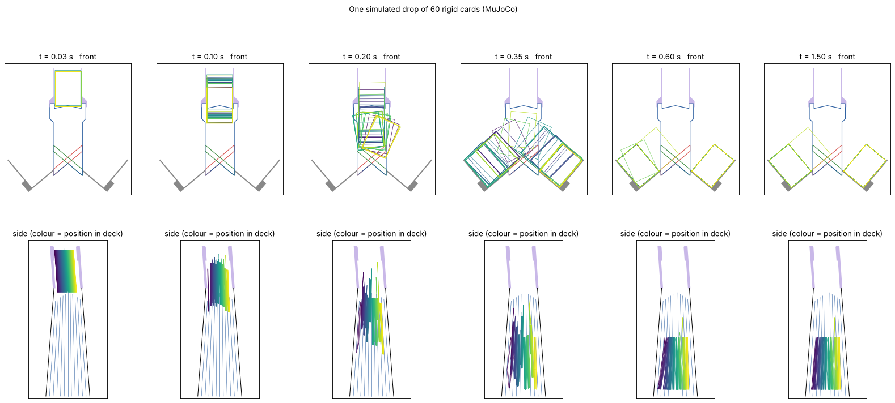

# Gravity comb shuffler for sleeved cards

A fully 3D-printed shuffler with no motor, springs, screws or moving parts.
Lower a 60-card sleeved deck into the top, lift two piles out of the bins,
stack them, repeat.

**Status: designed and simulated, not printed.** The geometry is checked by
the test suite and by a rigid-body physics simulation (MuJoCo). The design has
been through four versions, each driven by a failure in that simulation. The
current one delivers every card in 63 of 64 simulated drops under nominal
conditions. It still has known limits, listed below, and a simulation of rigid
cards is not a print.


## How it works

1. **Hopper.** The deck goes in short edge down, lowered by its edges through
   the finger slots until it almost touches the blades. The hopper leans back
   4 degrees, so the deck does too.
2. **Comb.** Eleven blades, 5 mm apart at the rim, slice the deck into packets
   of about seven cards.
3. **Ramps.** Each channel has a 40 degree floor. Channels alternate left,
   right, left, right. A packet free-falls one card height, lands on a corner,
   tips onto its short edge and slides out sideways.
4. **Bins.** Left-going and right-going packets collect in two tilted bins
   against a full-height fence, with finger notches for lifting them out.
5. **Repeat.** Put the left pile on the right pile and go again.

## What makes the comb not jam

Getting 60 cards through a comb under their own weight was the whole problem.
Four things turned out to matter, and removing any one of them brings the jams
back (each is a test in section 9 of `test_shuffler.py`):

- **The blades fan out.** They are tilted like the ribs of a fan hinged 400 mm
  above the rim, under a degree apart. The bottoms of the cards can then spread
  by the thickness of all the blades while the tops stay together, and every
  channel gets wider on the way down. With parallel blades the same comb
  delivers 49% of cards.
- **Each blade thickens slowly.** One 0.2 mm layer at the tip, 1 mm thick
  110 mm lower. Slowly enough that no channel ever narrows: whatever the tips
  let in can fall. Thickening over 20 mm instead delivers 28%.
- **Blade faces are flush.** The taper runs right across each blade, ears
  included. A 0.5 mm step there caught cards as they swung out sideways.
- **The deck arrives slightly tilted.** Cards then meet the blades one side
  first and none is left balanced on a tip. An upright hopper leaves a stray
  card in about one drop in five; the leaning one in one drop in 64.

The slices that make up the comb have slightly wedge-shaped spacers, so
stacking them builds the fan. The machine is 60 mm deep inside at the rim and
95 mm at the table.

## Simulation results

`physics_sim.py` builds the card-facing surfaces from the same parameters as
the CAD and drops rigid cards into them. Card edges are modelled two ways,
because it changes the outcome: rounded (a sleeve's folded edge) and square (a
rigid cut plate).



| Condition | Clean drops | Cards delivered | What went wrong |
|---|---|---|---|
| Nominal, rounded edges | 63 of 64 | 100.0% | one card stopped on a ramp |
| Nominal, square edges | 41 of 64 | 99.2% | 30 cards perched on blade tips |
| Dropped from 30 mm | 31 of 32 | 99.9% | |
| Deck 3 degrees more leaning | 32 of 32 | 100% | |
| Deck 3 degrees more upright | 28 of 32 | 98.5% | 3 comb jams |
| Slippery cards (friction 0.12 / 0.20) | 32 of 32 | 100% | |
| Grippy cards (0.35 / 0.50) | 31 of 32 | 99.9% | cards stop short of the fence |
| Thin cards (0.5 mm, 29% air) | 32 of 32 | 100% | |
| 40-card deck | 32 of 32 | 100% | |
| Tight deck, 12% air | 20 of 32 | 97.4% | 5 comb jams |
| Tight deck, 10% air | 0 of 32 | 73% | comb jams every drop |
| Dropped from the top of the hopper (90 mm) | 14 of 32 | 81% | comb jams in 9 drops |

Twelve consecutive drops with restacking in between: no card left behind in
any of them.

## Known limits

- **Tight decks jam.** The narrowest point of a channel holds a seven-card
  packet plus half a card, as long as at least about an eighth of the deck's
  thickness is air. The nominal deck here is 14% air (0.6 mm cards at 0.7 mm
  spacing). A relaxed sleeved deck is probably looser than that, but one
  squeezed between finger and thumb is not. I found no geometry that fixes
  this: deeper chevrons, wider spacing and a two-stage comb were all worse or
  no better. The finger slots are the mitigation: hold the deck by its edges.
- **Dropping the deck in from above jams.** A deck arriving at over 1 m/s
  cannot spread in time. Up to 30 mm is fine. The full-height fences keep the
  cards in the machine when it happens.
- **Square-edged cards perch.** With square rigid edges, a single card comes to
  rest on a blade tip, leaning on the hopper ring, in about a third of drops.
  It is in plain view. With rounded edges this did not happen in 64 drops.
- **Piles are untidy.** The bins are much deeper than a 30-card pile, so the
  cards lean. They come out in order, but need squaring up.
- **Simulation limits.** Cards are rigid, friction is guessed, and the blades
  are modelled as rigid. Printed blades are 0.2 to 1 mm thick and will flex.

### If it jams

1. Lift the hopper off. A card standing on the blades can be picked out.
2. A packet stuck lower down can be pushed through with the printed
   `jam_key`, which is thin enough for any channel and long enough to reach
   the ramps.
3. If it jams repeatedly, the deck is too tight: riffle it once to let air in,
   and lower it by its edges.

## How many drops

One drop is an inverse riffle shuffle done in seven-card clumps, so it takes
more drops than a hand riffle. Removing the jams also removed a side effect
that had been helping: earlier versions delayed a card at about half the cuts,
which moved single cards around. Those versions needed about 13 drops; this
one needs more.

| Drops | Adjacent pairs still together (model) | Same, 12-drop physics run |
|---|---|---|
| 1 | 82% | 83% |
| 5 | 38% | 39% |
| 10 | 15% | 14% |
| 12 | 11% | 8% |
| 15 | 7% | |
| 20 | 4% | |

A fully random deck scores 1.7%. By eight drops every card is equally likely
to be at any position. Fifteen drops is reasonable for casual play; about
twenty is thorough. A finer comb needs fewer (about 14 with five-card
packets) but is less tolerant of tight decks.

## Size and printing

Assembled: 315 wide x 101 deep x 326 tall mm (234 without the hopper). Needs a
bed of at least 250 x 250 mm; the wall halves are 158 x 235 mm. Roughly 450 g
of filament at 15% infill (estimated from 760 cm3 of solid volume). No
supports.

| File (in `out/`) | Qty | Orientation (files are already oriented) |
|---|---|---|
| `slice_00` ... `slice_11` | 1 each | blade on the bed, rib up |
| `back_L`, `back_R`, `front_L`, `front_R` | 1 each | wall on the bed, half a bin floor standing up |
| `hopper` | 1 | upside down, throat ring on the bed |
| `bar_ear`, `bar_low`, `bar_bin` | 2 each | lying down, slot vertical (84, 108 and 116 mm long) |
| `wedge` | 6 | flat |
| `foot` | 2 | on its side |
| `jam_key` | 1 | flat |

`out/assembly.step` is the whole machine for viewing or editing in CAD.

Settings: 0.4 mm nozzle, **0.2 mm layers** (blade tips are exactly one layer),
3 perimeters. Use PETG for the slices because the blades are thin; PLA is fine
for everything else. Sand any blob off the blade tips.

## Assembly

1. Stack slices 00 to 11 in order. Slices 00 to 05 go blade towards the front,
   06 to 11 blade towards the back, so the two middle blades touch. The stack
   fans out towards the bottom; that is intended. The small notches on the
   right-hand edge form one diagonal line when the order is correct.
2. Stand the stack between the four wall pieces. The two halves of each bin
   floor meet in the middle.
3. Push the six bars through from the back (short ones at the top, longest
   through the bin fences) and tap a wedge, narrow end first, into each slot
   until snug. Do not over-drive them; squeezing the stack bows the blades.
4. Press the two feet onto the bottom edges and set the hopper on top, leaning
   towards the back.

## Use

Hold the deck by its long edges, short edge down. Lower it through the finger
slots until it is just above the blades, resting back against the hopper, and
let go. Pinch each pile through the notches, put left on right, square up,
repeat.

## Changing it

All dimensions are fields of `Params` in `shuffler_design.py`.

```
pip install cadquery mujoco pytest matplotlib
python shuffler_design.py out     # regenerate STL + STEP
python render.py .                # regenerate the pictures
python physics_sim.py 12          # 12 simulated drops, about a minute
pytest test_shuffler.py           # 108 checks, about 8 minutes on 4 cores
pytest test_shuffler.py -k "not Physics and not Limits"    # geometry only, 15 s
```

- **Larger or double sleeves:** set `sleeve_w`, `sleeve_h`, `card_pitch`
  (about 0.8 for double-sleeved) and `n_channels=14`, then re-run the physics.
- **Fan angle:** hinge heights of 300 to 550 mm all worked; 250 squeezes the
  tops of the packets together and 1500 is too close to parallel.
- **Hopper lean:** 4 degrees. 6 was as good nominally but worse off-nominal,
  and 8 was worse outright.
- **Bed of 320 mm or more:** the wall halves could be merged into single
  plates; the split at the centre line exists only to fit 250 mm beds.

## Tried and rejected

Each of these was simulated and made things worse or no better: raked
(scissor-like) blade tips, a deeper chevron, a two-stage comb with alternate
blades starting lower, lane walls reaching into the bins at two heights, a
hopper flared below the ring, and a ring raised above the deck.
