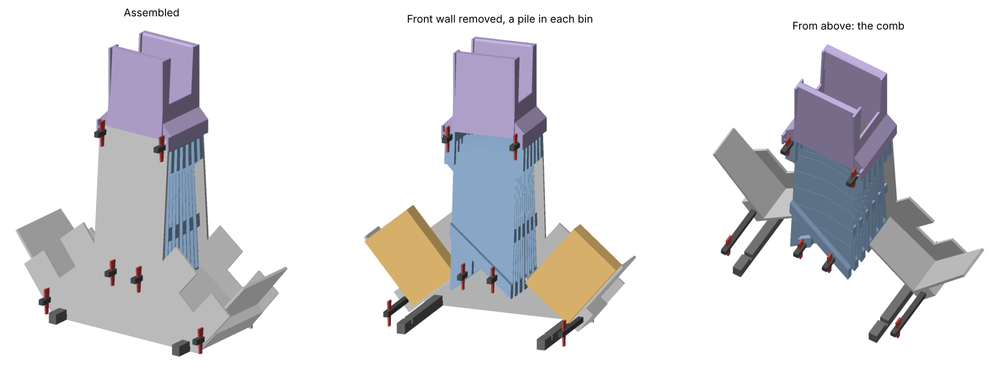

# Gravity comb shuffler for sleeved cards

A fully 3D-printed shuffler with no motor, springs, screws or moving parts.
Drop a 90 to 100 card sleeved deck into the top, lift two piles out of the
bins, stack them, repeat.

**Status: designed and simulated, not printed.** The geometry is checked by
the test suite and by a rigid-body physics simulation (MuJoCo). The design has
been through nine versions, each driven by a failure in that simulation. The
current one delivers every card in 64 of 64 simulated drops under nominal
conditions (90 and 100 cards) and at least 98% of cards in every condition
except a nearly solid deck. It still has known limits, listed below, and a
simulation of rigid cards is not a print.




## How it works

1. **Hopper.** The deck goes in short edge down. It can be lowered by its
   edges through the finger slots or simply dropped in from the top.
2. **Comb.** Seventeen blades, 5 mm apart at the rim, slice the deck into
   packets of about seven cards.
3. **Ramps.** Each channel has a 46 degree floor. Channels alternate left,
   right, left, right. A packet free-falls one card height, lands on a corner,
   tips onto its short edge and slides out sideways.
4. **Bins.** Left-going and right-going packets collect in two tilted bins
   against a full-height fence, with finger notches for lifting them out. The
   bins are 35 mm longer than a card.
5. **Repeat.** Put the left pile on the right pile and go again.

## What makes the comb not jam

Getting 60 cards through a comb under their own weight was the whole problem.
Seven things turned out to matter, and removing any one of them brings the jams
back (each is a test in section 9 of `test_shuffler.py`):

- **The blades fan out.** They are tilted like the ribs of a fan hinged 400 mm
  above the rim, under a degree apart. The bottoms of the cards can then spread
  by the thickness of all the blades while the tops stay together, and every
  channel gets wider on the way down. With parallel blades the same comb
  delivers 49% of cards.
- **Each blade thickens slowly.** One 0.2 mm layer at the tip, 1 mm thick
  110 mm lower. Slowly enough that no channel ever narrows: whatever the tips
  let in can fall. Thickening over 20 mm instead delivers 28%.
- **Blade faces are flush.** The taper runs right across each blade, ears
  included. A 0.5 mm step there caught cards as they swung out sideways.
- **Nothing leans.** Two earlier versions leaned the hopper, then the whole
  machine, to stop cards balancing on blade tips and arriving late. A leaning
  hopper tilts the cards against half the channels, and a deck dropped from
  the top then locked solid in 8 drops of 16. Once the bins were fixed (below)
  neither lean was needed.
- **The blade tips are thin enough to give.** The top 14 mm of each blade is a
  0.2 mm film, and it stays under 0.4 mm for 27 mm. Modelled as a rigid knife, a deck with a tenth of its
  thickness air jams in 25 drops of 32. Modelled as the PETG film it would
  really be, the tips give by under half a millimetre and the same deck
  delivers 99.6%. The result is the same from a third to three times the
  stiffness of PETG, so it is not finely tuned. Do not thicken the tips.

- **The comb is printed in 0.1 mm layers.** A blade printed flat thickens one
  layer at a time, and every layer is a small ledge on the wall cards slide
  down. With 0.2 mm ledges a deck with a tenth air went from 32 clean drops in
  32 to 29, and a nearly solid one from 90% delivered to 78%.
- **Cards must get clear of the tower.** With 40 degree ramps and bins barely
  longer than a card, some cards stopped short of the fence with a corner
  still under the tower, and later cards landed on them. Steeper ramps and
  longer bins took a drop from the top of the hopper from 21 clean drops in
  32 to 32, and a tight deck from 19 to 31.

The slices that make up the comb have slightly wedge-shaped spacers, so
stacking them builds the fan. The machine is 90 mm deep inside at the rim and
152 mm at the table.

## Simulation results

`physics_sim.py` builds the card-facing surfaces from the same parameters as
the CAD and drops rigid cards into them. Two modelling choices change the
outcome, so both are explicit: card edges are rounded (a sleeve's folded edge)
or square (a rigid cut plate), and blade tips are flexible films or rigid.
Unless stated, results are for rounded edges and flexible tips, 32 drops each.


Blades modelled as printed, thickening in 0.1 mm steps, with flexible tips:

| Condition | Clean drops | Cards delivered | What went wrong |
|---|---|---|---|
| 100 cards | 32 of 32 | 100% | |
| 90 cards | 32 of 32 | 100% | |
| 60 cards | 32 of 32 | 100% | |
| Dropped from 30 mm | 32 of 32 | 100% | |
| Dropped from 50 mm | 32 of 32 | 100% | |
| Dropped from the top of the hopper (90 mm) | 32 of 32 | 100% | |
| Deck leaning 4 degrees in the hopper | 32 of 32 | 100% | |
| Table 3 degrees off level, either way | 32 of 32 each | 100% | |
| Slippery cards (friction 0.12 / 0.20) | 32 of 32 | 100% | |
| Grippy cards (friction 0.35 / 0.50) | 30 of 32 | 99.9% | one card left, twice |
| Tight deck, 12% air | 32 of 32 | 100% | |
| Tight deck, 10% air | 32 of 32 | 100% | |
| Tight deck, 6% air | 8 of 32 | 89.9% | packets of eight wedge part way down |
| Square-edged cards | 9 of 32 | 98.9% | a card perched on a blade tip |

Square-edged cards with rounded bottom corners (smooth-taper blade model):

| Corner radius | Clean drops |
|---|---|
| 0 (square) | 12 of 32 |
| 0.05 mm | 9 of 32 |
| 0.10 mm | 11 of 32 |
| 0.15 mm | 20 of 32 |
| 0.20 mm | 24 of 32 |
| 0.30 mm (fully round, as a folded sleeve) | 32 of 32 |

No condition here stops the whole deck.

### Loads

- **Blades.** The flexible top of each blade bends at most 0.7 mm (a nearly
  solid deck), a bending stress of about 0.5 MPa against roughly 50 MPa that
  PETG can take. Dropping the deck in from the top bends them 0.15 mm. Not
  modelled: a card corner denting the film locally.
- **Cards.** The fastest card moves at 1.6 m/s when the deck is lowered in and
  1.9 m/s when it is dropped from the top: the same as a card dropped onto a
  table from 13 to 18 cm.

## Known limits

These are the two conditions under which the simulated machine still leaves
cards behind. Neither has a design fix that does not make the common case
worse; both are about the cards, and both need a real deck to settle.

- **Nearly solid decks.** Decks with a tenth of their thickness as air are
  clean in 32 drops of 32. Squeezed to 6% air, a packet of eight cards is
  5.3 mm thick, the channel is 4.8 mm at the tip and widens only slowly, so
  about one card in ten is left behind. Wider blade spacing (`channel_w=4.5`)
  raises that to 97% but costs clean drops for 10%-air and nominal decks; a
  stronger fan does the same. A deck squeezed between finger and thumb can be
  this tight; a deck held by its edges should not be. If your deck is known to
  be very tight, build with `channel_w=4.5`.
- **Square-edged cards.** A card with a square, rigid bottom edge can stand on
  a blade tip with its top leaning on the hopper, in about two drops of three.
  It is in plain view and is a single card. The sweep above shows it fading
  as the edge rounds; a sleeve's folded bottom edge is about fully round, so
  this should not occur with sleeved cards, but only a real deck can confirm
  it. Thinner blade tips did not help.
- **Drop count.** About 15 drops for casual play and two dozen for a thorough
  shuffle of 100 cards. That is set by the seven-card packets; smaller
  packets brought the jams back, and restacking habits (turning the deck round,
  either pile on top, cutting) make no difference. More than two output piles
  would halve it, but that is a different machine.
- **Piles are untidy.** Cards land standing in their own lanes, so a 50-card
  pile is spread across about 100 mm of a 150 mm-deep bin instead of being a
  35 mm stack. They come out in order, but need gathering up. Tilting the bin
  floors 5 to 15 degrees towards the back did not gather them: friction holds
  each card where it landed.
- **Simulation limits.** Cards are rigid and friction is guessed. Blade-tip
  flexibility is modelled as a sprung hinge, which captures bending but not
  buckling or creasing. The next step is a printed prototype, not more
  simulation.

### If cards are left behind

1. Lift the hopper off. Cards standing in the comb can be picked out and
   added to the deck for the next drop.
2. A packet stuck lower down can be pushed through with the printed
   `jam_key`, which is thin enough for any channel and long enough to reach
   the ramps.
3. If it happens often, the deck is being squeezed too tight: riffle it once
   to let air in, and hold it by its edges.

## How many drops

One drop is an inverse riffle shuffle done in seven-card clumps, so it takes
more drops than a hand riffle. Removing the jams also removed a side effect
that had been helping: early versions delayed a card at about half the cuts,
which moved single cards around.

| Drops | Adjacent pairs still together, 100 cards (model) |
|---|---|
| 1 | 82% |
| 5 | 37% |
| 10 | 15% |
| 15 | 6% |
| 20 | 3% |
| 25 | 2% |

A fully random 100-card deck scores 1%. By eight drops every card is equally
likely to be at any position. Fifteen drops is reasonable for casual play;
about two dozen is thorough. A finer comb needs fewer (about 16 with
five-card packets) but is less tolerant of tight decks. The model is
`shuffle_sim.py`, calibrated against consecutive simulated drops of the
60-card version.

## Size and printing

Assembled: 361 wide x 158 deep x 369 tall mm (277 without the hopper). Needs a
bed of at least 250 x 250 mm; the largest pieces are 180 x 232 mm. Roughly
650 g of filament at 15% infill (estimated from 1,130 cm3 of solid volume). No
supports. 40 pieces in all.

| File (in `out/`) | Qty | Orientation (files are already oriented) |
|---|---|---|
| `slice_00` ... `slice_17` | 1 each | blade on the bed, rib up |
| `back_L`, `back_R`, `front_L`, `front_R` | 1 each | wall on the bed, half a bin floor standing up |
| `upper_front`, `upper_back` | 1 each | flat |
| `hopper` | 1 | upside down, throat ring on the bed |
| `bar_ear`, `bar_low`, `bar_bin` | 2 each | lying down, slot vertical (115, 153 and 172 mm long) |
| `wedge` | 6 | flat |
| `foot` | 2 | on its side |
| `jam_key` | 1 | flat |

`out/assembly.step` is the whole machine for viewing or editing in CAD.

Settings: 0.4 mm nozzle, 3 perimeters. Print the comb slices at **0.1 mm
layers** in PETG: the top of each blade is a 0.2 mm film that is meant to
flex, and the blade thickens one layer at a time below it. Everything else can
be 0.2 mm layers in PLA.

## Assembly

1. Stack slices 00 to 17 in order. Slices 00 to 08 go blade towards the front,
   09 to 17 blade towards the back, so the two middle blades touch. The stack
   fans out towards the bottom; that is intended. The small notches on the
   right-hand edge form one diagonal line when the order is correct.
2. Stand the stack between the four lower wall pieces; the two halves of each
   bin floor meet in the middle. Add the two upper wall plates, which overlap
   the lower pieces in a half lap.
3. Push the six bars through from the back (short ones at the top, longest
   through the bin fences) and tap a wedge, narrow end first, into each slot
   until snug. Do not over-drive them; squeezing the stack bows the blades.
4. Press the two feet onto the bottom edges and set the hopper on top.

## Use

Hold the deck by its long edges, short edge down. Lower it through the finger
slots until it is just above the blades and let go, or drop it in from the top
of the hopper. Pinch each pile through the notches, put left on right, square up,
repeat.

## Changing it

All dimensions are fields of `Params` in `shuffler_design.py`.

```
pip install cadquery mujoco pytest matplotlib
python shuffler_design.py out     # regenerate STL + STEP
python render.py .                # regenerate the pictures
python physics_sim.py 12          # 12 simulated drops, about a minute
pytest test_shuffler.py           # 129 checks, about 45 minutes on 4 cores
pytest test_shuffler.py -k "not Physics and not Limits"    # geometry only, 15 s
```

- **Larger or double sleeves:** set `sleeve_w`, `sleeve_h`, `card_pitch`
  (about 0.8 for double-sleeved) and `n_channels=22`, then re-run the physics.
- **Fan angle:** hinge heights of 300 to 550 mm all worked; 250 squeezes the
  tops of the packets together and 1500 is too close to parallel.
- **Leaning the machine:** `machine_tilt_deg` cuts the feet as wedges. Not
  needed with the current bins.
- **Smaller decks:** set `n_cards` and `n_channels` (60 cards needs 12).
- **Larger beds:** the end walls are in three pieces each only to fit 250 mm
  beds.

## Tried and rejected

Each of these was simulated and made things worse or no better: raked
(scissor-like) blade tips, a deeper chevron, a two-stage comb with alternate
blades starting lower, lane walls reaching into the bins at two heights, a
hopper flared below the ring, a ring raised above the deck, a hopper that
leans on its own, a single leading centre blade, wider blade spacing,
thinner lower blades, a forward-shifted hopper, a finer comb, blades on the
outer side of their channels, a second row of short blades halfway down, and
one-layer (0.1 mm) blade tips, and bin floors tilted towards the back.
